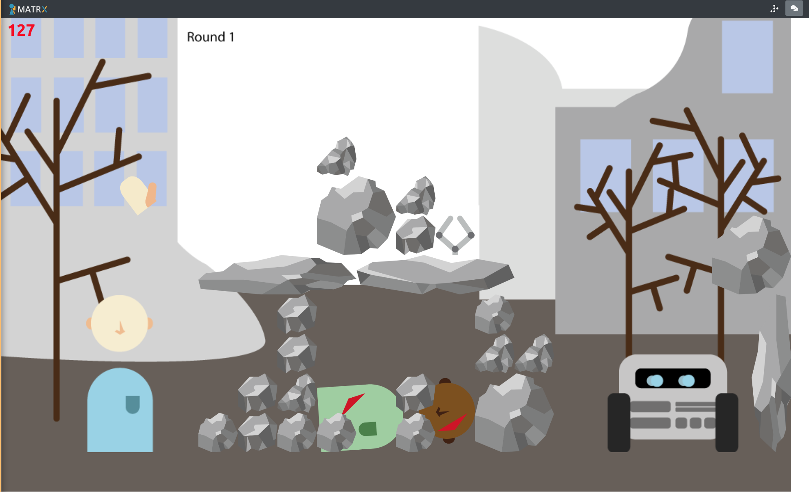
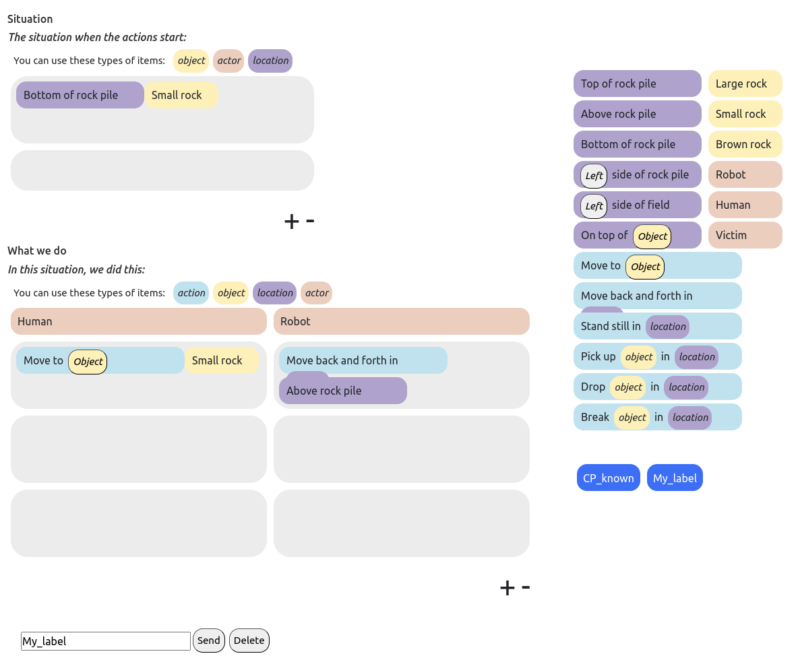
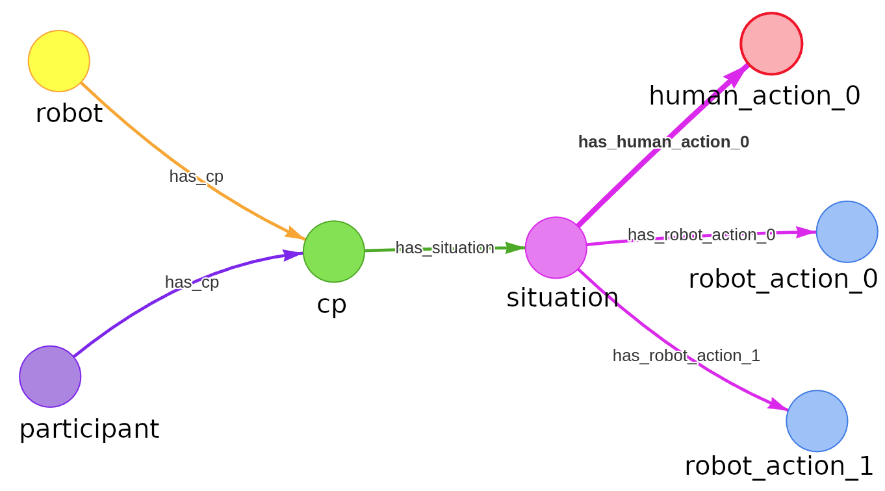
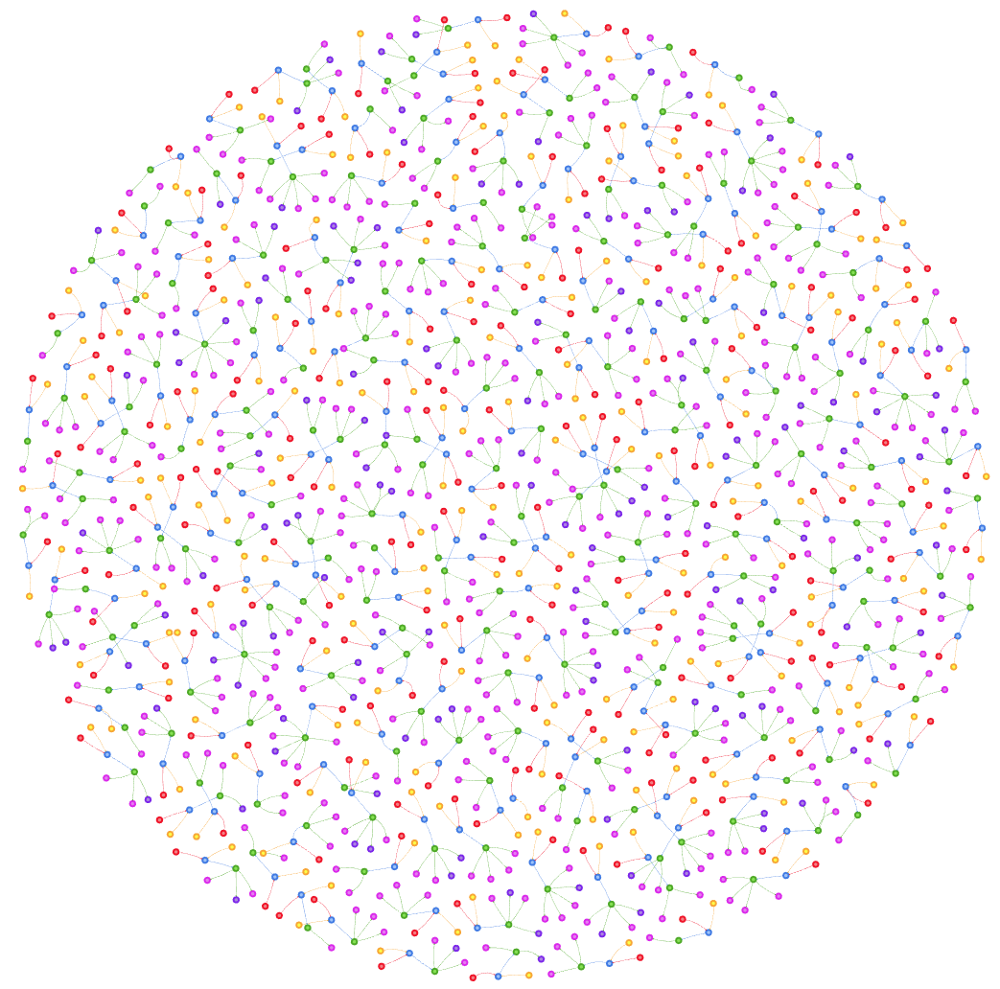
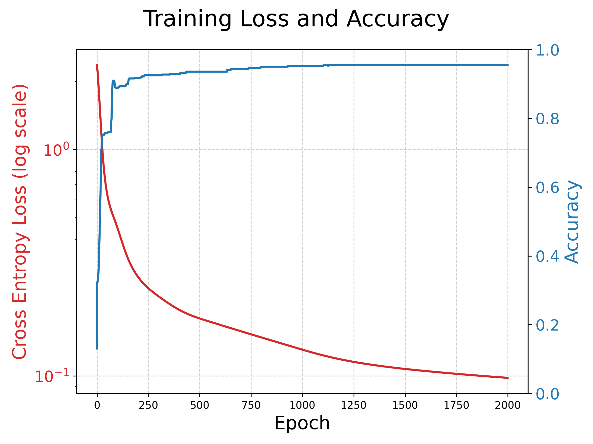
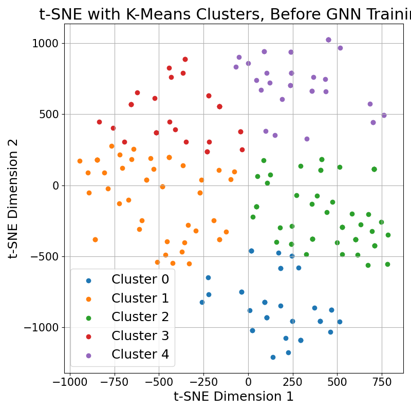
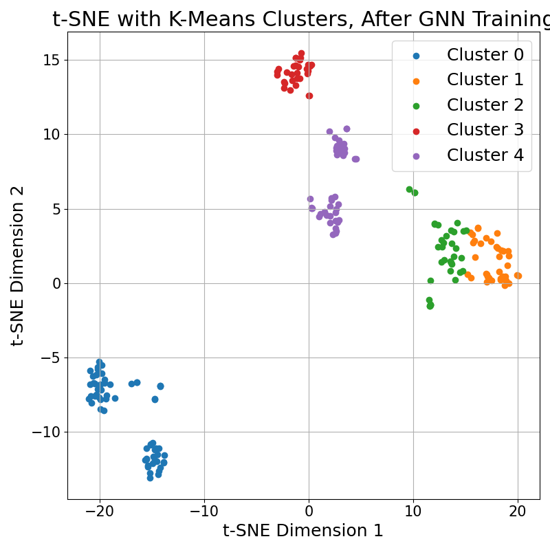

# Co-Learning

**Authors:** [Taewoon Kim](https://taewoon.kim/), [Emma van Zoelen](https://www.linkedin.com/in/emma-van-zoelen-822a6296/), and [Mark Neerincx](https://www.tno.nl/en/about-tno/our-people/mark-neerincx/).

Code, data, and analysis for the RO-MAN 2026 paper *Improving Human-Robot Teamwork
in Urban Search and Rescue Through Episodic Memory of Prior Collaboration*. We
represent previously observed human-robot collaboration patterns (CPs) as
knowledge-graph episodic memories, use graph representation learning to select a
representative prior pattern, and preload it into the robot before a new
collaboration episode in the [MATRX](https://matrx-software.com/) Urban Search and
Rescue (USAR) environment.

For the research overview, see the [project page](https://humem.ai/research/co-learning)
or the paper on [arXiv](https://arxiv.org/abs/2606.18836).

This README focuses on the repository layout, environment setup, and how to
reproduce the paper assets.

## The MATRX USAR environment

A human and a collaborative robot work together to free a buried victim by clearing
rubble, while minimizing elapsed time and avoiding additional harm from falling rocks.
Participants document the collaboration patterns they observe with the robot through a
dedicated drag-and-drop interface and a chat interface.

| MATRX USAR simulation | Collaboration-pattern interface |
| :-------------------: | :-----------------------------: |
|  |  |

## Repository layout

It is organized around four top-level areas:

- [`runtime/`](./runtime): MATRX USAR experiment code, assets, visualizer, schema, and runtime configuration
- [`data/`](./data): processed dataset and raw CSV inputs used for the paper analyses
- [`analysis/`](./analysis): graph-learning notebooks, helper code, and generated analysis figures
- [`paper/`](./paper): accepted paper source and supplementary material

In more detail:

- [`main.py`](./main.py): thin entrypoint for launching the interactive MATRX experiment from the repo root
- [`runtime/custom_visualizer/`](./runtime/custom_visualizer): Flask-based visualizer used by the experiment UI
- [`runtime/images/`](./runtime/images): images used by the MATRX environment and visualizer
- [`runtime/loggers/`](./runtime/loggers): runtime logging helpers
- [`runtime/typedb-schema/`](./runtime/typedb-schema): TypeDB schema and seed data for collaboration-pattern storage
- [`runtime/latin_square_list.csv`](./runtime/latin_square_list.csv): participant-to-scenario ordering used by the experiment runner
- [`data/raw-data.json`](./data/raw-data.json): processed collaboration-pattern dataset used by the paper analyses
- [`data/user-raw-data/new/`](./data/user-raw-data/new): raw CSV inputs used to regenerate `data/raw-data.json`
- [`analysis/graph_learning.py`](./analysis/graph_learning.py): utilities for parsing raw data and generating RDF-style graph artifacts
- [`analysis/process-raw-data.ipynb`](./analysis/process-raw-data.ipynb): notebook that regenerates `data/raw-data.json` from the raw CSV files
- [`analysis/graph-learning-humemai.ipynb`](./analysis/graph-learning-humemai.ipynb): notebook for the HumemAI / JanusGraph / RGCN analysis workflow used for the paper figures
- [`analysis/figures/`](./analysis/figures): generated analysis figures referenced by the supplementary material
- [`paper/roman-2026/`](./paper/roman-2026): accepted paper source, references, figures, and compiled PDF
- [`paper/supplementary-material/`](./paper/supplementary-material): supplementary markdown, figures, and PDF

The `humemai-research` package is not vendored here. Install it from PyPI when you
need the JanusGraph-based analysis workflow.

## Collaboration patterns as knowledge graphs

People externalize the collaboration patterns they discover during teamwork, and we
treat each one as a knowledge graph that preserves the situation, the ordered action
sequence, and the task outcome. We collected 209 such CPs from earlier MATRX studies.

| Example collaboration pattern | All 209 collaboration patterns |
| :---------------------------: | :----------------------------: |
|  |  |

## Prerequisites

1. Python 3.10 or higher
1. A virtual environment is recommended

Create a virtual environment and install the Python dependencies:

```bash
python -m venv .venv
source .venv/bin/activate
pip install -r requirements.txt
```

The analysis notebook also uses the published package:

```bash
pip install humemai-research
```

## External services

The MATRX runtime uses TypeDB for collaboration-pattern storage during the
interactive experiment.

- Install TypeDB Server / Console / Studio separately.
- Start the server on `localhost:1729`.
- Create the `CP_ontology` database.
- Load the schema from `runtime/typedb-schema/CP_ontology_schema_corrected.tql`.
- Load any required seed data from `runtime/typedb-schema/Basic_Instances.tql` if your experiment setup expects it.

## Reproducing the paper assets

### 1. Rebuild the processed dataset

Open [`analysis/process-raw-data.ipynb`](./analysis/process-raw-data.ipynb) and run
it against the CSV files in [`data/user-raw-data/new/`](./data/user-raw-data/new).
The output is `data/raw-data.json`.

### 2. Run the graph-learning analysis

Open [`analysis/graph-learning-humemai.ipynb`](./analysis/graph-learning-humemai.ipynb).
This notebook:

- writes the collaboration patterns into JanusGraph through `humemai-research`
- constructs the graph representation of each collaboration pattern
- trains the RGCN used in the paper analysis
- produces the clustering and training figures used in the manuscript and supplementary material

[`analysis/graph_learning.py`](./analysis/graph_learning.py) contains the reusable
parsing and graph-construction helpers used by that workflow.

### 3. Run the interactive MATRX experiment

```bash
python main.py
```

You will be prompted for:

- the starting scenario number
- the participant number, which also determines the visualizer port

Then open the visualizer in a browser at:

```text
http://localhost:<participant-number>/human-agent/human_selector
```

Keyboard controls:

- Arrow keys: move
- `b`: pick up / select
- `n`: drop

## Results

A two-layer RGCN is trained with a node-classification objective, and the pooled
graph embeddings are clustered with K-means to select one representative CP for reuse.

| RGCN training loss and accuracy |
| :-----------------------------: |
|  |

| K-means clusters before training | K-means clusters after training |
| :------------------------------: | :-----------------------------: |
|  |  |

In a human-subject study with 20 participants (160 round-level observations),
initializing the robot with a single automatically selected prior CP raised rescue
success from **25.7% to 41.3%** and reduced average task time by **283 seconds**, with
the strongest gains at the very beginning of the interaction. The benefit is not
uniform: victim harm rises on average and performance drops in the hardest later
rounds, consistent with a mismatch between the reused CP and scenarios where a brown
rock changes the local risk of debris removal.

## Further reading

- [Project page](https://humem.ai/research/co-learning)
- [Paper on arXiv](https://arxiv.org/abs/2606.18836)
- [MATRX software](https://matrx-software.com/)

## Cite our paper

```bibtex
@misc{kim2026improvinghumanrobotteamworkurban,
      title={Improving Human-Robot Teamwork in Urban Search and Rescue Through Episodic Memory of Prior Collaboration}, 
      author={Taewoon Kim and Emma van Zoelen and Mark Neerincx},
      year={2026},
      eprint={2606.18836},
      archivePrefix={arXiv},
      primaryClass={cs.HC},
      url={https://arxiv.org/abs/2606.18836}, 
}
```
